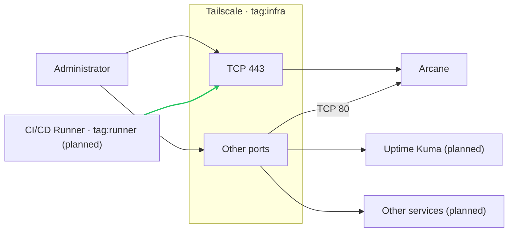

# CI/CD Infrastructure

A small self-hosted CI/CD playground using Docker, Arcane, and Tailscale.

I wanted a server that runs application images without checking out application source repositories or building them on the server. The management dashboard should stay private. I'm still figuring out the best way to put everything together, and a few decisions here came from things breaking.

**Status:** Arcane and Tailscale work locally (WSL and an Android client). VPS deployment and automated CI/CD are not verified yet.

## Why am I doing this?

At work, we deploy applications directly over SSH. Everything runs within a private network, and there's a dedicated team responsible for network security, access control, and infrastructure protection. A lot of the security concerns are already taken care of for us.

I could theoretically do the same here. But this is a public repository using GitHub-hosted runners, and I don't have a dedicated infrastructure team behind me. I'd rather put a few more guardrails in place than give a CI runner direct shell access to my server.

Arcane also supports Git Sync, which would probably make things simpler. Scheduled polling introduces a delay between publishing a change and detecting it, though. I want to experiment with event-driven deployments instead. Git Sync can also be triggered by a webhook, so this isn't an argument against GitOps in general.

I'm using this project as an excuse to learn about the things I usually don't have to deal with at work: private networking, OIDC, access policies, and infrastructure security.

Am I overcomplicating things? Probably. But that's kind of the point. This is a learning project, not a production reference architecture.

## Deployment strategy (planned)

GitHub Actions will lint, test, build, and publish the Go application's image to GHCR. After a successful push, the runner temporarily joins Tailscale as `tag:runner` and calls Arcane's inbound webhook over HTTPS. Arcane pulls the image and handles deployment.

This is an image-based deployment with a push-based trigger, not scheduled Git Sync. The VPS doesn't need to clone the application repository. Cloudflared will expose only the Go application, never Arcane or its webhook.

## Architecture



The administrator can access all infrastructure ports. The runner is restricted to TCP 443, reserved for Arcane. This is a network-level restriction, not API-level authorization; runner access is not tested yet.

Arcane and Tailscale run in separate Compose projects, sharing one network namespace. No host ports are published in the server configuration, and Tailscale Funnel is disabled. I chose a shared gateway to avoid running a Tailscale container for every app; I haven't actually benchmarked the resource savings.

## Repository layout

```text
cicd-infra/
├── infra/
│   ├── arcane/
│   │   ├── compose.yml
│   │   ├── compose.local.yml
│   │   └── .env.example
│   ├── tailscale/
│   │   ├── compose.yml
│   │   ├── .env.example
│   │   └── config/serve.json
│   ├── setup.sh
│   └── teardown.sh
├── projects/                 # Runtime files, ignored by Git
├── .gitignore
└── README.md
```

## Setup

Requirements: Docker, Docker Compose v2, Bash, a Tailscale account, and a connected Tailscale client for testing.

### 1. Configure Tailscale

In [Access Controls](https://login.tailscale.com/admin/acls), create these tags with `autogroup:admin` as the owner:

| Tag | Description |
| --- | --- |
| `tag:infra` | Shared Tailscale gateway for private infrastructure services and management dashboards. |
| `tag:runner` | Automation identity with restricted access to infrastructure services required for CI/CD deployments. |

Create two **General access rules** (not Tailscale SSH):

| Field | Administrator access | Runner access |
| --- | --- | --- |
| Source | Your account email | `tag:runner` |
| Destination | `tag:infra`, `tag:runner` | `tag:infra` |
| Port and protocol | `*` | `tcp:443` |
| Description | Allow administrators full access to private infrastructure and CI/CD runner nodes. | Allow CI/CD runners to access Arcane for automated deployments over HTTPS. |

Remove or narrow the default allow-all rule after checking that other devices won't lose required access. Grants are additive. The runner rule allows the entire HTTPS listener, not individual API endpoints; Arcane authentication is still required. Keep port 443 dedicated to Arcane.

In [Keys](https://login.tailscale.com/admin/settings/keys), generate an **auth key**, not an API token:

- Description: `infra-gateway`
- Reusable: off
- Expiration: 1 day
- Ephemeral: off
- Tags: `tag:infra`

Enable MagicDNS and HTTPS certificates in [DNS settings](https://login.tailscale.com/admin/dns). The runner identity is reserved for GitHub Actions; don't assign it to the gateway.

### 2. Prepare environment files

From the repository root:

```bash
mkdir -p projects
realpath projects
id -u
id -g

(umask 077; cp -n infra/tailscale/.env.example infra/tailscale/.env)
(umask 077; cp -n infra/arcane/.env.example infra/arcane/.env)
chmod 600 infra/tailscale/.env infra/arcane/.env
```

What these commands do:

- `umask 077` removes group and other permissions from newly created files. Normally, new files become `600` and directories become `700`. Parentheses keep this change inside a subshell, so it doesn't affect the rest of your terminal session.
- `cp -n` copies the template without overwriting an existing `.env`.
- `chmod 600` explicitly sets permissions on the existing files: the owner can read and write (`6 = 4 + 2`), while the group and everyone else have no access (`0`). This also protects files that already existed before the copy.

These permissions protect secrets from ordinary local users, not from root or privileged Docker access.

Generate an encryption key. Run this and copy the output:

```bash
docker run --rm ghcr.io/getarcaneapp/manager:latest /app/arcane generate secret
```

**`infra/tailscale/.env`**

```dotenv
TS_AUTHKEY=your-one-time-auth-key
TS_HOSTNAME=infra-local
```

**`infra/arcane/.env`**

```dotenv
ARCANE_APP_URL=https://infra-local.example-tailnet.ts.net
ARCANE_ENCRYPTION_KEY=your-generated-key
PROJECTS_DIR=/absolute/path/to/cicd-infra/projects
PUID=1000
PGID=1000
TZ=Asia/Jakarta
```

Use your actual tailnet DNS name, project path, UID and GID. Keep the project path identical on the host and inside Arcane because it deploys through the host Docker socket. Keep the encryption key stable across updates and back it up with Arcane's data.

### 3. Optional: test Arcane without Tailscale

```bash
cd infra/arcane
docker compose -f compose.yml -f compose.local.yml up -d
```

Open <http://localhost:3552>. Only Arcane's `.env` is required. The local override binds the published port to localhost and explicitly overrides the server network settings. It is not automatically loaded by Compose.

Stop this stack before testing Tailscale:

```bash
docker compose -f compose.yml -f compose.local.yml down
cd ../..
```

### 4. Start the private stack

From the repository root:

```bash
bash infra/setup.sh
```

The script validates both stacks, starts Tailscale before Arcane, and recreates Arcane if the gateway container ID changes.

The current `infra/tailscale/config/serve.json` provides HTTPS and an IPv4 fallback:

```json
{
  "TCP": {
    "443": { "HTTPS": true },
    "80": { "TCPForward": "127.0.0.1:3552" }
  },
  "Web": {
    "${TS_CERT_DOMAIN}:443": {
      "Handlers": {
        "/": { "Proxy": "http://127.0.0.1:3552" }
      }
    }
  }
}
```

Port 80 is a private TCP forward for clients with DNS problems, not a public HTTP endpoint. Prefer HTTPS whenever possible.

Verify:

```bash
docker ps
docker exec tailscale tailscale status
docker exec tailscale tailscale serve status
docker exec tailscale wget -S -O /dev/null http://127.0.0.1:3552
```

Expect HTTP 200 from the last command. From a connected, authorized client, open the HTTPS URL shown by Serve or `http://<tailscale-ip>:80`. Test again with Tailscale disconnected and verify that access fails.

Once registered, the non-reusable auth key is consumed. You can clear `TS_AUTHKEY` from `.env` and rerun setup to remove it from the container environment. The persistent state volume preserves the node identity.

### 5. Sign in to Arcane

Sign in as `arcane`. Arcane generates the password on first start and writes it to `/app/data/initial-admin-password`. Run the following to copy the file out:

```bash
cd infra/arcane
(umask 077; docker compose cp arcane:/app/data/initial-admin-password .)
chmod 600 initial-admin-password
cat initial-admin-password
```

Sign in, change the password, and remove the copied file (`rm initial-admin-password`). Don't commit it. If using the local override, include both Compose files in the `cp` command as well.

### 6. Teardown and restart

From the repository root:

```bash
bash infra/teardown.sh
bash infra/setup.sh
```

Teardown stops Arcane before Tailscale with a 30-second shutdown timeout. Both scripts are intended to be repeatable. Run them twice independently to test idempotency. Avoid shutting down during deployments; the timeout doesn't guarantee every operation finishes.

Named volumes are preserved. **Do not use `down -v`** unless you deliberately want to delete persistent data.

## Things that broke (and what I learned)

- **MagicDNS didn't work on my Android phone.** Accessing Tailscale Serve over IPv4 returned a 404, likely due to hostname-based routing. TCP forwarding solved this without exposing any Docker ports.
- **Shared network namespaces can be tricky.** Tailscale suddenly couldn't reach Arcane (`connection refused`). Recreating Arcane fixed it. I suspect a stale network namespace, but I didn't collect enough evidence to confirm that.
- **Persistent state matters.** Tailscale doesn't need a new auth key on every restart. Preserving its state volume keeps the existing node identity and IP address.
- **Renaming a node doesn't change its tags.** Migrating from `tag:arcane` to `tag:infra` temporarily broke access. Updating the existing node's ACL tags fixed it without restarting or re-registering the node.

## Security guardrails

Already configured and tested locally:

- Private Arcane access through Tailscale, no published management ports or Funnel. Administrator and runner grants are separate; runner access itself is not tested yet.
- Secrets outside Git, owner-only `.env` files, and persistent state preserved across restarts.

Before enabling automated deployments:

- Protect `main` and deployment workflows; untrusted pull requests only run unprivileged CI.
- Use short-lived OIDC authentication scoped to the trusted repository and branch/environment, with ephemeral `tag:runner` nodes and minimal workflow permissions.
- Reserve TCP 443 for Arcane; use a dedicated, project-scoped webhook credential if supported, never an admin credential or SSH access. Keep the webhook URL out of logs and Git.
- Pin third-party Actions to full commit SHAs and use tested image versions; plan immutable application image tags or digests, rollback, and deployment concurrency control.
- Keep Cloudflared limited to the Go application, enable MFA, and back up state and encryption keys.

A few risks remain: Arcane's Docker socket is effectively host-level privilege, shared network namespaces allow local communication outside Tailscale grants, and the gateway is a single point of failure. HTTP over Tailscale is network-encrypted but lacks application-layer TLS; prefer HTTPS. A compromised deployment runner could still publish or deploy a malicious image within its granted privileges. None of this is a claim of production readiness.

Root `.gitignore` should include:

```gitignore
.env
.env.*
!.env.example
/projects/
initial-admin-password
*.pem
*.key
```

Check `git diff --cached` and ensure real `.env` files are not already tracked. Gitignore cannot undo a previous secret leak.

## VPS deployment

Clone only this infrastructure repository. Repeat environment setup with a new one-time auth key, a new Arcane encryption key (for a fresh database), hostname `infra`, and the correct server paths and IDs. Run `bash infra/setup.sh` and verify access. Never enable the local Compose override on the VPS.

Application images will eventually come from GHCR, not an application repository checkout. Images themselves may still contain application code depending on how they're built.

## What's next

### Phase 1 — Make it work

- [x] Arcane standalone and private local integration
- [x] Shared gateway, access policies, setup and teardown scripts
- [ ] Build a small Go backend in a separate repository, with linting, tests, and a multi-stage Dockerfile
- [ ] Deploy infrastructure to the VPS and improve readiness checks
- [ ] Set up GitHub Actions and GHCR with restricted workflow permissions
- [ ] Configure short-lived Tailscale runner authentication via OIDC
- [ ] Integrate Arcane's inbound webhook and verify runner access boundaries
- [ ] Expose only the Go backend through Cloudflare Tunnel
- [ ] Test automated deployment, rollback, and failure cases
- [ ] Set up Uptime Kuma for monitoring

Done when a push to `main` can deploy the application without SSH or an application repository checkout on the VPS.

### Phase 2 — Software supply chain security

- [ ] Scan Go dependencies with `govulncheck`
- [ ] Scan the built container image with Trivy before publishing to GHCR
- [ ] Scan the repository for secrets with Gitleaks
- [ ] Block HIGH and CRITICAL image vulnerabilities, with documented exceptions if needed
- [ ] Rescan published images periodically for newly discovered vulnerabilities
- [ ] Experiment with SBOM generation and image signing/verification with Cosign (optional)

Build once, scan that same image, and publish it only if the security checks pass. Scanning runs in CI, not as another permanent service on the VPS.

I want to get the deployment working before adding more tools to the pipeline. That doesn't mean skipping the Phase 1 access controls: restricted grants, OIDC, webhook authentication, workflow permissions, and secrets management are still part of the baseline. Automated scanning comes later, and until then the images are not automatically checked for known vulnerabilities.

The infrastructure works locally. The actual deployment pipeline is still a work in progress, and I expect a few more things to break along the way.

References: [Arcane](https://getarcane.app/docs/) · [Tailscale Docker](https://tailscale.com/kb/1282/docker) · [Tailscale Serve](https://tailscale.com/kb/1242/tailscale-serve) · [Docker Compose](https://docs.docker.com/compose/)
