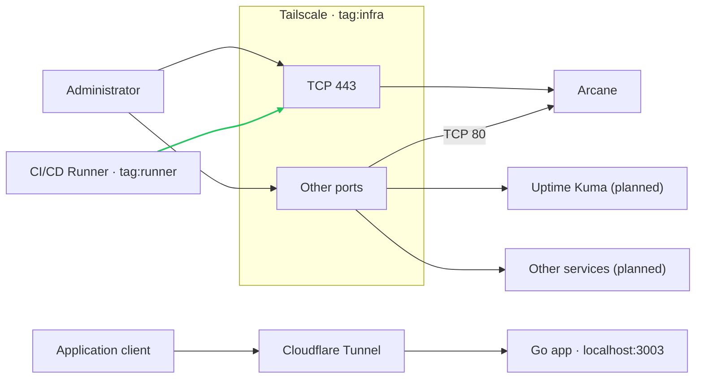

# CI/CD Infrastructure

A small self-hosted CI/CD playground using Docker, Arcane, and Tailscale.

This learning project runs application images without building them or checking out application source on the VPS. The management dashboard stays private. It is not a production reference architecture.

**Status:** Arcane, Tailscale, Cloudflared, and the demo application run on the VPS. A push to `main` has published and deployed an image through the private Arcane webhook. Arcane and Tailscale recovered after a reboot, and the public `/health` and `/version` endpoints work through Cloudflare Tunnel. Rollback and live failure tests remain.

## Why am I doing this?

At work, I deploy applications over SSH within a private network. I built this project to show the kind of deployment work I do and to explore a different way of putting the pieces together.

At work, a dedicated team handles network security, access control, and infrastructure protection. Here, I get to explore those concerns myself. Tailscale is new to me, and I think it's really cool: it lets me experiment with private networking while keeping the management dashboard and deployment webhook off the public internet.

This public project uses GitHub-hosted runners, so I also wanted to add guardrails rather than give a runner direct shell access to my server. My main goal is to keep development source code off the VPS and run only the built application image. Arcane's Git Sync requires a repository checkout on the server; it could sync a separate deployment-only repository, but I chose an image-based webhook workflow. I also wanted to experiment with event-driven deployments rather than scheduled polling. Git Sync supports webhooks too, so this isn't an argument against GitOps in general.

Along the way, I'm learning about OIDC, access policies, and infrastructure security. Am I overcomplicating things? Probably. But that's the point: this is a learning project, not a production reference architecture.

## Deployment strategy

GitHub Actions runs lint and race tests, builds one Go image, and publishes it to GHCR with full commit SHA and `main` tags. The runner temporarily joins Tailscale as `tag:runner` using OIDC, then calls Arcane's project redeploy webhook over HTTPS. Arcane pulls `:main`. Cloudflared exposes only the app, never Arcane or its webhook.

Publication and webhook notification share a job-level concurrency lock, and the job checks that its SHA is the current `main` head before updating `:main`. The workflow treats HTTP 202 as a successful notification; it does not wait for deployment completion. The lock ends when Arcane accepts the request, so a later run can move `:main` before an earlier deployment pulls it. GitHub may replace pending runs, and only this application's publish job participates in the lock. Check Arcane's event log and `/version` for the actual outcome.

## Architecture



The policy gives the administrator access to infrastructure ports and restricts the runner to TCP 443, reserved for Arcane. Runner access to the gateway on TCP 443 has been tested. This is a network-level restriction, not API-level authorization.

Arcane and Tailscale share a network namespace across separate Compose projects. Arcane publishes no host ports, and Tailscale Funnel is disabled. Cloudflared uses host networking to reach the app at `127.0.0.1:3003`.

## Application and image

The Go backend lives in [cicd-demo](https://github.com/nabilfikrisp/cicd-demo). It uses Gin and provides a simple in-memory service catalog; data resets on restart. It listens on port `3003` by default and exposes `/health` and `/version`. The repository includes linting, race tests, and a multi-stage Dockerfile.

GitHub Actions runs lint and tests on pull requests and pushes to `main`; both checks are required by the application's `main` ruleset. Pull request checks have read-only repository permissions. After both checks pass on a push to `main`, a separate publish job builds and pushes the image; only that job has `packages: write`.

The public image, `ghcr.io/nabilfikrisp/cicd-demo`, is published under the full commit SHA and `:main`; `/version` identifies the running commit. If the package becomes private, the publish job can use `GITHUB_TOKEN` with `packages: write` while repository Actions retains write access to the package. Arcane will need registry credentials from an account with package access and a `read:packages` token. Private pulls through Arcane have not been tested.

### Runner and webhook credentials

The application repository stores `TS_OIDC_CLIENT_ID`, `TS_OIDC_AUDIENCE`, and `ARCANE_WEBHOOK_URL` as GitHub Actions secrets. The Tailscale federated identity has Auth Keys write access for `tag:runner` and trusts this GitHub immutable subject:

```text
repo:nabilfikrisp@79518623/cicd-demo@1471480995:ref:refs/heads/main
```

A name-only subject caused an OIDC HTTP 403; Tailscale's Trust credentials page showed the received subject. The webhook secret uses the tailnet HTTPS hostname on port 443, even if Arcane's dialog displays an HTTP IP and port. Preserve the complete webhook path and token, and keep the URL out of Git and logs.

## Repository layout

```text
cicd-infra/
├── infra/
│   ├── arcane/
│   │   ├── compose.yml
│   │   ├── compose.local.yml
│   │   └── .env.example
│   ├── cloudflared/
│   │   ├── compose.yml
│   │   └── .env.example
│   ├── tailscale/
│   │   ├── compose.yml
│   │   ├── .env.example
│   │   └── config/serve.json
│   ├── setup.sh
│   └── teardown.sh
├── projects/                 # Runtime files, ignored by Git
├── .gitignore
└── README.md
```

## Setup

Requirements: Docker, Docker Compose v2, Bash, a Tailscale account and connected client, and a Cloudflare account with a configured tunnel.

### 1. Configure Tailscale

In [Access Controls](https://login.tailscale.com/admin/acls), create these tags with `autogroup:admin` as the owner:

| Tag | Description |
| --- | --- |
| `tag:infra` | Shared Tailscale gateway for private infrastructure services and management dashboards. |
| `tag:runner` | Automation identity with restricted access to infrastructure services required for CI/CD deployments. |

Create two **General access rules** (not Tailscale SSH):

| Source | Destination | Port and protocol |
| --- | --- | --- |
| Your account email | `tag:infra`, `tag:runner` | `*` |
| `tag:runner` | `tag:infra` | `tcp:443` |

Remove or narrow the default allow-all rule after checking that other devices won't lose required access. Grants are additive. The runner rule allows the entire HTTPS listener, not individual API endpoints; Arcane authentication is still required. Keep port 443 dedicated to Arcane.

In [Keys](https://login.tailscale.com/admin/settings/keys), generate an **auth key**, not an API token:

- Description: `infra-gateway`
- Reusable: off
- Expiration: 1 day
- Ephemeral: off
- Tags: `tag:infra`

Enable MagicDNS and HTTPS certificates in [DNS settings](https://login.tailscale.com/admin/dns). The runner identity is reserved for GitHub Actions; don't assign it to the gateway.

### 2. Prepare environment files

From the repository root:

```bash
mkdir -p projects
realpath projects
id -u
id -g

(umask 077; cp -n infra/tailscale/.env.example infra/tailscale/.env)
(umask 077; cp -n infra/arcane/.env.example infra/arcane/.env)
(umask 077; cp -n infra/cloudflared/.env.example infra/cloudflared/.env)
chmod 600 infra/tailscale/.env infra/arcane/.env infra/cloudflared/.env
```

These commands preserve existing `.env` files and restrict them to the owner. Root and users with privileged Docker access can still read the secrets.

Generate an encryption key. Run this and copy the output:

```bash
docker run --rm ghcr.io/getarcaneapp/manager:latest /app/arcane generate secret
```

**`infra/tailscale/.env`**

```dotenv
TS_AUTHKEY=your-one-time-auth-key
TS_HOSTNAME=infra-local
```

**`infra/arcane/.env`**

```dotenv
ARCANE_APP_URL=https://infra-local.example-tailnet.ts.net
ARCANE_ENCRYPTION_KEY=your-generated-key
PROJECTS_DIR=/absolute/path/to/cicd-infra/projects
PUID=1000
PGID=1000
TZ=Asia/Jakarta
```

Use your actual tailnet DNS name, project path, UID and GID. Keep the project path identical on the host and inside Arcane because it deploys through the host Docker socket. Keep the encryption key stable across updates and back it up with Arcane's data.

**`infra/cloudflared/.env`**

```dotenv
TUNNEL_TOKEN=your-cloudflare-tunnel-token
```

Create a Cloudflare Tunnel and configure the application's public hostname to route to HTTP `127.0.0.1:3003`. The connector uses host networking. Keep the token private and do not route Arcane through the tunnel.

### 3. Optional: test Arcane without Tailscale

```bash
cd infra/arcane
docker compose -f compose.yml -f compose.local.yml up -d
```

Open <http://localhost:3552>. Only Arcane's `.env` is required. The local override binds the published port to localhost and explicitly overrides the server network settings. It is not automatically loaded by Compose.

Stop this stack before testing Tailscale:

```bash
docker compose -f compose.yml -f compose.local.yml down
cd ../..
```

### 4. Start the private stack

From the repository root:

```bash
bash infra/setup.sh
```

The script validates all three stacks, starts Tailscale before Arcane, recreates Arcane if the gateway container ID changes, and starts Cloudflared. It reports container status but does not verify service readiness.

`infra/tailscale/config/serve.json` configures tailnet-only HTTPS on port 443 and a private TCP forward on port 80 for clients with DNS problems. Prefer HTTPS.

Verify:

```bash
docker ps
docker exec tailscale tailscale status
docker exec tailscale tailscale serve status
docker exec tailscale wget -S -O /dev/null http://127.0.0.1:3552
```

Expect HTTP 200 from the last command. From a connected, authorized client, open the HTTPS URL shown by Serve or `http://<tailscale-ip>:80`. Test again with Tailscale disconnected and verify that access fails.

Once registered, the non-reusable auth key is consumed. You can clear `TS_AUTHKEY` from `.env` and rerun setup to remove it from the container environment. The persistent state volume preserves the node identity.

### 5. Sign in to Arcane

Sign in as `arcane`. Arcane generates the password on first start and writes it to `/app/data/initial-admin-password`. Run the following to copy the file out:

```bash
cd infra/arcane
(umask 077; docker compose cp arcane:/app/data/initial-admin-password .)
chmod 600 initial-admin-password
cat initial-admin-password
```

Sign in, change the password, and remove the copied file (`rm initial-admin-password`). Don't commit it. If using the local override, include both Compose files in the `cp` command as well.

### 6. Teardown and restart

From the repository root:

```bash
bash infra/teardown.sh
bash infra/setup.sh
```

Teardown stops Arcane before Tailscale with a 30-second shutdown timeout; it does **not** stop Cloudflared. To stop Cloudflared separately, run `docker compose --project-directory infra/cloudflared --env-file infra/cloudflared/.env -f infra/cloudflared/compose.yml down`. Avoid shutting down during deployments; the timeout doesn't guarantee every operation finishes.

Named volumes are preserved. **Do not use `down -v`** unless you deliberately want to delete persistent data.

## Things that broke (and what I learned)

- MagicDNS failed on Android, and direct IPv4 access to Serve returned 404, likely due to hostname routing. The private TCP forward fixed access without publishing Docker ports.
- Tailscale once lost access to Arcane; recreating Arcane fixed it. A stale shared network namespace is suspected but unconfirmed.
- Preserving Tailscale's state volume keeps its identity and IP across restarts. Renaming a node does not change its ACL tags; updating the tags fixed access after migrating to `tag:infra`.

## Security guardrails

Configured and tested:

- Private Arcane access through Tailscale, no published management ports or Funnel. Administrator and runner grants are separate; the runner has reached Arcane on TCP 443.
- Secrets outside Git, owner-only `.env` files, and persistent state preserved across restarts.

Ongoing security work:

- The Tailscale admin console reports a known security vulnerability on a machine and recommends updating it to version `1.104.7`. Identify the affected machine, update it to a supported fixed version, and verify connectivity afterward.
- The application's `main` ruleset requires lint and tests, and pull request checks have read-only repository permissions. Protect future deployment workflows as well.
- Maintain the short-lived OIDC identity scoped to the trusted repository and branch, ephemeral `tag:runner` nodes, and minimal workflow permissions.
- Reserve TCP 443 for Arcane; use the project-scoped webhook credential, never an admin credential or SSH access. Keep the webhook URL out of logs and Git.
- Pin third-party Actions to full commit SHAs, use tested image versions, and test rollback and deployment concurrency behavior.
- Keep Cloudflared limited to the Go application, enable MFA, and back up state and encryption keys.

A few risks remain: Arcane's Docker socket is effectively host-level privilege, shared network namespaces allow local communication outside Tailscale grants, and the gateway is a single point of failure. HTTP over Tailscale is network-encrypted but lacks application-layer TLS; prefer HTTPS. A compromised deployment runner could still publish or deploy a malicious image within its granted privileges. None of this is a claim of production readiness.

Check `git diff --cached` and ensure real `.env` files are not already tracked. Gitignore cannot undo a previous secret leak.

## VPS deployment

For a fresh VPS, clone this infrastructure repository, prepare the three environment files above, and run `bash infra/setup.sh`. Use a fresh Tailscale auth key and, for a fresh Arcane database, a new encryption key. Never enable the local Compose override on the VPS.

The demo app was deployed manually over SSH from a Compose file under the ignored `projects/` directory, without cloning its source repository on the VPS. Its port is bound to `127.0.0.1:3003`. Verify `/health` and `/version` locally and through the Cloudflare hostname; the public GHCR package requires no registry credentials.

### Project configuration and persistence (planned)

Version-control the application and PostgreSQL Compose definitions, Nginx configuration, and `.env.example` files as templates. Keep the live project files that Arcane manages under the ignored `projects/` directory:

```text
project-templates/           # Planned, tracked configuration templates
├── cicd-demo/               # Application and Nginx
└── postgres/                # Database
projects/                    # Ignored live project files on the VPS
├── cicd-demo/
└── postgres/
```

These template directories have not been created yet. Initially, copy reviewed template changes to the live project directories over SSH; tracked templates do not update live files automatically. This is separate from application image deployment, which uses the Arcane webhook over Tailscale without runner SSH access. Automating configuration delivery is future work.

Keep real `.env` files and credentials out of Git. PostgreSQL data belongs in a persistent Docker volume with tested backups and restore procedures, not in the template or live project directory. Run PostgreSQL as a separate Compose project on a shared private Docker network, without a public host port. Database migrations and upgrades need their own deliberate workflow.

An Arcane project redeploy webhook has been tested manually and through GitHub Actions. Its tokenized URL is a secret. A `202 Accepted` response only confirms the request was accepted; check Arcane's event log and the app's `/version` to confirm the deployment. Rollback and live failure cases remain to be tested.

After the single-instance deployment works, the plan is to add persistent shared storage, such as PostgreSQL, before running multiple backend instances behind a simple load balancer. Each instance currently has its own in-memory catalog, so multiple instances would return inconsistent data and lose it on restart. With shared storage and multiple instances in place, test health-gated rolling or blue-green deployments under continuous requests; multiple instances alone do not guarantee zero downtime.

## What's next

### Phase 1 — Make it work

- [x] Arcane standalone and private local integration
- [x] Shared gateway, access policies, setup and teardown scripts
- [x] Build a small Go backend in a separate repository, with linting, tests, and a multi-stage Dockerfile
- [x] Deploy infrastructure to the VPS and test reboot recovery
- [ ] Improve infrastructure readiness checks
- [x] Deploy the demo application manually and verify its endpoints
- [x] Create and manually test the Arcane project webhook
- [x] Set up GitHub Actions and GHCR with restricted workflow permissions
- [x] Configure short-lived Tailscale runner authentication via OIDC
- [x] Integrate Arcane's inbound webhook and verify runner access to TCP 443
- [x] Expose only the Go backend through Cloudflare Tunnel
- [x] Test automated deployment
- [ ] Test rollback and live publication and notification failure cases
- [ ] Set up Uptime Kuma for monitoring

Done when a push to `main` can deploy the application without SSH or an application repository checkout on the VPS.

### Phase 2 — Software supply chain security

- [ ] Scan Go dependencies with `govulncheck`
- [ ] Scan the built container image with Trivy before publishing to GHCR
- [ ] Scan the repository for secrets with Gitleaks
- [ ] Block HIGH and CRITICAL image vulnerabilities, with documented exceptions if needed
- [ ] Rescan published images periodically for newly discovered vulnerabilities
- [ ] Experiment with SBOM generation and image signing/verification with Cosign (optional)

Build once, scan that same image, and publish it only if the security checks pass. Scanning runs in CI, not as another permanent service on the VPS.

Automated scanning comes later; images are not yet automatically checked for known vulnerabilities. Phase 1 access controls remain part of the baseline.

References: [Arcane](https://getarcane.app/docs/) · [Tailscale Docker](https://tailscale.com/kb/1282/docker) · [Tailscale Serve](https://tailscale.com/kb/1242/tailscale-serve) · [Docker Compose](https://docs.docker.com/compose/)
